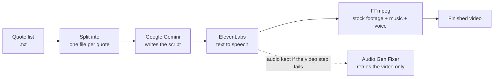

# 2024 Archive: Python Automation Scripts

The Python tools I wrote in 2024 while learning AI-assisted programming and automation, kept here for history. They are small single-purpose scripts, written with AI assistance, and they are not maintained.

Everything is in [`2024/`](2024/). The original notes are in [`2024/readme.md`](2024/readme.md).

## The main project: an automated quote-video pipeline

Most of these scripts feed one idea: turn a text file of quotes into finished narrated videos with as little manual editing as possible.

- `AI_AUTO_VIDEO_MAKER`, `All-In-One AUTO VIDEO MAKER`: the whole pipeline in one run, over many quote files.
- `FFMPEG_VIDEO_MAKER`, `Video Maker Separate Programs`, `VideoStitcher`: the video assembly step on its own.
- `Audio Gen Fixer`: rebuilds a video from audio that was already generated, so a failed run does not spend text-to-speech credits twice.

## Everything else, by category

| Category | Folders |
|---|---|
| Video utilities (FFmpeg) | Vertical Video Converter, Video_Splitter, Video_Trimmer, Video_FadeIn-Out, VIDEO_FPS_CONVERTER, Video_Converter_Program, VideoAppender, Video_2s_Adder, Video_LastFrame_Grabber, Video_STILL_FRAME_CAPTURE, Video_Random_Segment, Video_Music_Adder, Video_Volume, Video_Podcast_Maker, Video_Music_Maker, IMG2Video, Subtitles_Generator, video_encoding_and_FPS_checker, Total_Duration |
| Audio | audio_trimmer, Audio_BG_Music_Looper, AudioQuoteStitcher, AudiobookStitcher, AutoElevenLabs_Combiner, Sample_rate_fixer, Silence Adder, Video_44.1khz_Converter |
| Generative AI APIs | Autoblog Gemini, AutoSeparate_Gemini, AutoMastermind, Replicate_Image_Generator, img2img_converter |
| Images and print-on-demand mockups | Printify Mockup Image Combiner, RATIO Printify Portrait Ratio Maker, AVIF_WEBP_Converter, DPI_Converter, Image_flipper, Transparency_Test, EXIF_Check_Move |
| Text | Random_Quote_Combiner, Text Separator, TEXT_Formatter_Quotes, TXT Docufier, TXT EPUB Converter, TXT Renamer |
| Files and datasets | File Organization Code, File_renamer, file_grabber, Random_File_Grabber, FolderStructure Copier, Name_Randomizer, SUFFIX-PREFIX-Adder |
| Other | Davinci_Text_Inserter, GPU_ID |

API keys in these scripts are placeholders. To run one, put your own key in the script's key variable, or better, read it from an environment variable.
